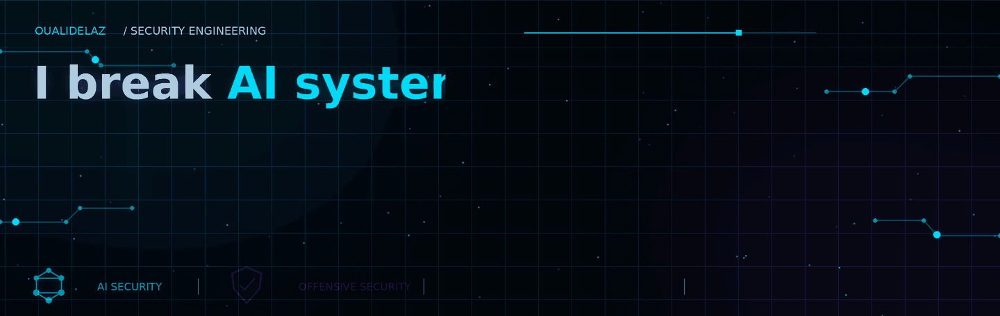

<!-- Hero Banner -->

  

<!-- Navigation -->

&nbsp;&nbsp;

&nbsp;&nbsp;

&nbsp;&nbsp;

  

---

<!-- Introduction -->
<h2 align="center">Security Engineering in Progress</h2>

  Building, testing, and securing modern systems across
  <strong>AI, networks, and cloud infrastructure.</strong>

  
  
  
  

  <code>UNDERSTAND</code> &nbsp;/&nbsp;
  <code>TEST</code> &nbsp;/&nbsp;
  <code>SECURE</code>

---

<!-- About Me: Left aligned -->
<h2 align="left">About Me</h2>

<ul>
  <li>Exploring AI security, LLMs, AI agents, and AI red teaming.</li>
  <li>Developing practical skills in penetration testing and security assessment.</li>
  <li>Learning network, operating system, and cloud infrastructure security.</li>
  <li>Building software and security projects through hands-on experimentation.</li>
</ul>

<h3 align="left">Current Focus</h3>

  <code>AI Security</code>
  <code>Offensive Security</code>
  <code>Network Security</code>
  <code>Cloud Security</code>
  <code>Software Engineering</code>

---

<!-- Security Engineering Identity: Left aligned -->
<h2 align="left">Security Engineering Identity</h2>

  I'm building toward <strong>Security Engineering</strong>, with a focus on
  understanding how modern systems work, how their trust boundaries fail,
  and how security weaknesses can be identified, validated, and mitigated.

  My technical interests span <strong>AI Security, Offensive Security,
  Network Security, and Cloud Security</strong>. I approach these domains
  from an engineering perspective: studying the underlying architecture,
  examining attack surfaces, testing security assumptions in authorized
  environments, and documenting findings in a reproducible way.

  I'm particularly interested in the security of AI-enabled applications
  and agentic systems, including how LLMs interact with external content,
  retrieval systems, tools, memory, APIs, and infrastructure.

