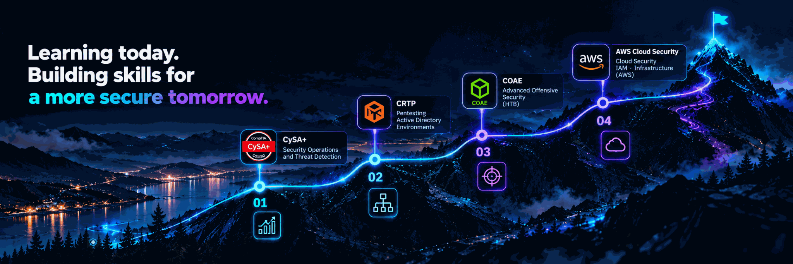

 

  

  

  

  

 

<h2>Security Engineering in Progress</h2>

  Building, testing, and securing modern systems across
  <strong>AI, networks, and cloud infrastructure.</strong>

  
  
  
  

  <code>UNDERSTAND</code>   /  
  <code>TEST</code>   /  
  <code>SECURE</code>

---

<h3>About Me</h3>

- Exploring AI security, LLMs, AI agents, and AI red teaming.
- Developing practical skills in penetration testing and security assessment.
- Learning network, operating system, and cloud infrastructure security.
- Building software and security projects through hands-on experimentation.

<h3>Current Focus</h3>

`AI Security` · `Offensive Security` · `Cloud Security` · `Software Engineering`

<h2>Security Engineering Identity</h2>

  I'm building toward <strong>Security Engineering</strong>, with a focus on
  understanding how modern systems work, how their trust boundaries fail,
  and how security weaknesses can be identified, validated, and mitigated.

  My technical interests span <strong>AI Security, Offensive Security,
  Network Security, and Cloud Security</strong>. I approach these domains
  from an engineering perspective: studying the underlying architecture,
  examining attack surfaces, testing security assumptions in authorized
  environments, and documenting findings in a reproducible way.

  I'm particularly interested in the security of AI-enabled applications
  and agentic systems, including how LLMs interact with external content,
  retrieval systems, tools, memory, APIs, and infrastructure.

<!-- Certification Roadmap -->

<h2 align="left">Certification Roadmap</h2>

  My current certification goals reflect my commitment to developing practical skills
  across cloud security, offensive security, and security operations.

  

  <strong>Learning path:</strong>
  Security Operations · Active Directory Penetration Testing ·
  Advanced Offensive Security · AWS Cloud Security

  
    These are target certifications and learning goals, not claims of certifications already earned.
  

<!-- ==================== SELECTED PROJECTS ==================== -->

<h2 align="center">Selected Projects</h2>

  Security Engineering · Research · Development

 

<table width="100%">
  <tr>
    <td width="150" align="center" valign="middle">
      
    </td>
    <td valign="middle">
      <h3>01 / RAG Against the Machine</h3>
      

        <code>Python</code> · <code>RAG</code> ·
        <code>Information Retrieval</code>
      

      A retrieval-augmented generation pipeline for document ingestion,
      chunking, search, and evaluation.
        
      🔵 In Progress
    </td>
  </tr>

  <tr>
    <td colspan="2">
      

    </td>
  </tr>

  <tr>
    <td width="150" align="center" valign="middle">
      
    </td>
    <td valign="middle">
      <h3>02 / Zero-to-Root Cybersecurity Lab</h3>
      

        <code>Vulnerability Assessment</code> ·
        <code>Network Defense</code>
      

      A hands-on security lab covering vulnerability assessment,
      traffic analysis, and system hardening.
        
      <a href="https://github.com/Oualidelaz/Zero-to-Root-Cybersecurity-Assessment-Defense-Lab">
        View Repository →
      </a>
    </td>
  </tr>

  <tr>
    <td colspan="2">
      

    </td>
  </tr>

  <tr>
    <td width="150" align="center" valign="middle">
      
    </td>
    <td valign="middle">
      <h3>03 / OSINT-Oelaz</h3>
      

        <code>Python</code> · <code>OSINT</code> ·
        <code>Automation</code>
      

      A Python toolkit for username discovery, IP intelligence,
      and automated platform checks.
        
      <a href="https://github.com/Oualidelaz/OSINT-Oelaz">
        View Repository →
      </a>
    </td>
  </tr>
</table>

 

  <a href="https://github.com/Oualidelaz?tab=repositories">
    <strong>EXPLORE ALL REPOSITORIES ↗</strong>
  </a>

